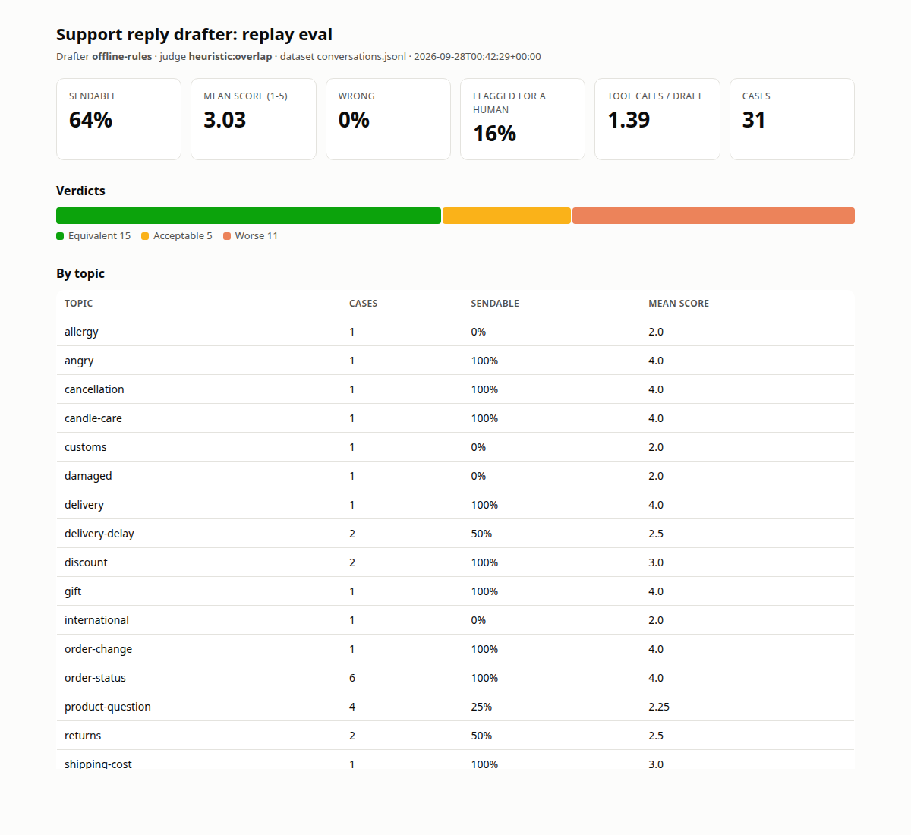
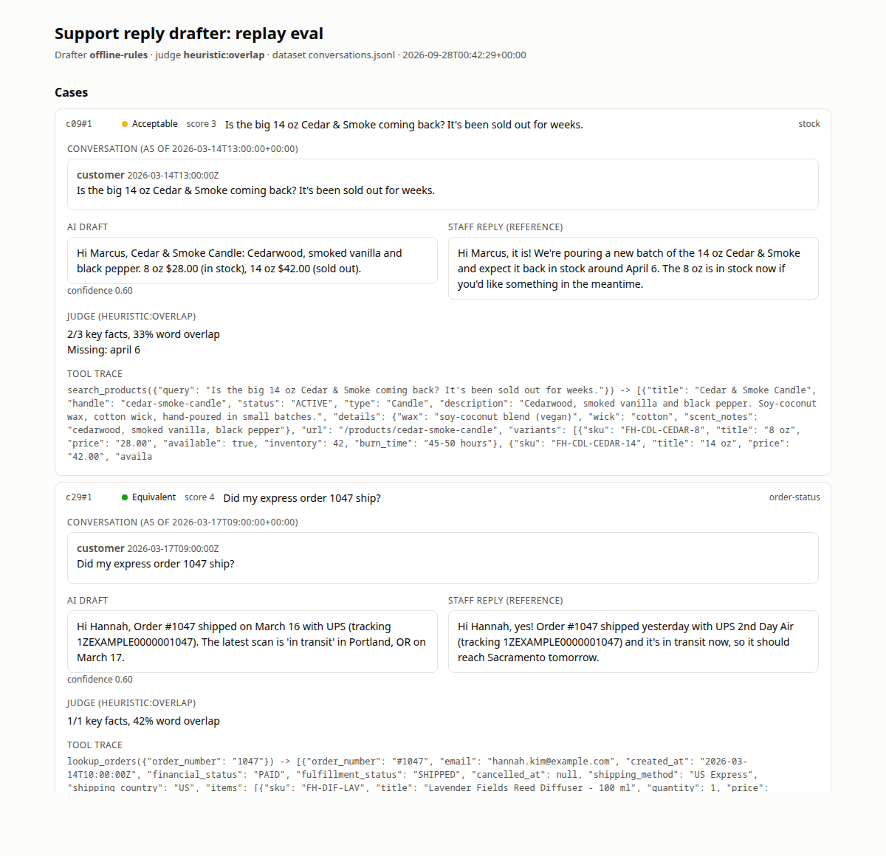

# support-reply-drafter

An LLM agent that drafts customer-support replies. It looks up orders, tracking, products and policies through
tool calls. The repo also includes a **replay eval harness**: it re-runs past conversations frozen at the moment the
customer wrote, and an LLM judge scores each draft against the reply staff actually sent.

It works with any OpenAI-compatible chat endpoint. Data sources plug in as adapters (a mock Shopify store is
included, plus a read-only Shopify Admin adapter). The tests run offline with no API key.



*The HTML report from `drafter eval`. This screenshot is from an **offline** run: the rule-based stand-in model
graded by the heuristic judge, on the synthetic dataset. It shows the report layout. The numbers are not a
model-quality measurement.*

## Why a replay eval

A drafting prompt is easy to demo and hard to measure. The useful question is: *if this had been running last
quarter, how many of its drafts could staff have sent?* The harness answers that directly:

1. Every staff reply in the history that answers a customer message becomes a **cut point**.
2. The drafter sees the conversation only up to that point.
3. The data adapters are **frozen at the time of the customer's message**. Orders placed later, shipments and
   tracking scans that hadn't happened yet, and cancellations and refunds processed later are all hidden. Without
   this, a replayed "where is my order?" would be answered with tomorrow's "delivered" scan, and the eval would
   reward a drafter for knowledge staff didn't have.
4. A judge model compares the draft with the staff reply. The staff reply is treated as the reference for **facts**
   (a restock date, a decision to replace), not for wording. The judge also sees the drafter's tool evidence, so a
   looked-up fact isn't mistaken for a hallucination. A draft that honestly defers to a human on something only
   staff knew (for example an unpublished restock date) counts as *acceptable*, not *wrong*.

The run reports the sendable rate (better, equivalent or acceptable), the mean 1-5 score, the wrong rate, how often
the drafter asked for a human, tool calls per draft, token usage, and a per-topic breakdown. The HTML report lets
you read every case side by side, with the full tool trace.



## Features

- **Tool-calling agent** (`reply_drafter/agent.py`). Tools: `lookup_orders`, `search_products`, `get_product`,
  `search_policies`, and a structured `submit_reply` with `reply`, `category`, `confidence`, `needs_human`,
  `human_reason` and `facts_used`. The final step forces `submit_reply`. Models that answer in plain text are
  nudged once. Tool or adapter failures come back to the model as errors instead of crashing the draft.
- **No send path, by design.** The agent can't refund, cancel, edit orders or message anyone. When a case needs
  someone to act or decide (a refund, a replacement, an address change, an angry or chargeback message), it drafts
  what staff would say and sets `needs_human`.
- **Provider-agnostic.** `OpenAICompatibleModel` takes `base_url`, `api_key` and `model`. It adds retries on 429
  and 5xx, a hard wall-clock deadline (`requests`' read timeout resets on every byte, so it isn't one), and
  `extra_body` for provider routing or reasoning options. The system prompt is byte-identical across drafts, so
  provider prompt caches can reuse it.
- **Pluggable data adapters** (`reply_drafter/adapters/`). Implement five methods: `store_profile`,
  `lookup_orders`, `search_products`, `get_product` and `search_policies`. Two are included:
  - `MockShopifyAdapter`: Shopify-shaped synthetic data with time travel via `as_of`.
  - `ShopifyAdminAdapter`: read-only Admin GraphQL (orders with fulfillment events, products, shop policies).
- **Judges.** `LLMJudge` is the real grader; keep its model fixed across runs so scores stay comparable. It uses a
  JSON rubric and salvages truncated output. `OverlapJudge` is an offline key-fact and word-overlap heuristic for
  tests and smoke runs only.
- **Offline mode.** `--provider offline` swaps in a deterministic rule-based stand-in that speaks the same
  tool-calling protocol. The whole pipeline, including the report, then runs without a key. It is a harness
  check, not a baseline.
- **Synthetic sample data.** `data/` holds a fictional candle shop: 11 products, 8 policies, 15 orders with
  carrier tracking events, and **30 hand-written conversations** (31 cut points) covering order status, delays,
  damaged and wrong items, returns, address changes, stock, discounts, wholesale, international shipping, pet
  safety and an angry chargeback threat. Some staff replies deliberately rely on facts the tools can't see (a
  restock date, a manager's decision), which tests how the drafter and judge handle "only staff knew this".

## Quick start

```bash
git clone https://github.com/brepre109/support-reply-drafter.git
cd support-reply-drafter
python3 -m venv .venv && . .venv/bin/activate
pip install -e ".[dev]"

pytest -q                                            # 36 offline tests

# No API key needed:
drafter draft --provider offline --conversation c29
drafter eval  --provider offline --judge heuristic   # writes runs/<id>/report.html
```

With a real model, any OpenAI-compatible endpoint works:

```bash
cp .env.example .env        # DRAFTER_BASE_URL / DRAFTER_API_KEY / DRAFTER_MODEL, JUDGE_MODEL
drafter draft --conversation c04
drafter draft --message "Do you ship to Canada?" --name Ana --email ana@example.com
drafter eval --limit 10 --seed 7 --workers 4         # LLM judge by default
drafter eval --topic order-status
drafter report runs/<run-id>                         # re-print the summary, rebuild the HTML
```

`--adapter shopify` (with `SHOPIFY_SHOP` and `SHOPIFY_ACCESS_TOKEN`) points the tools at a live store instead of the
mock. Only use it with `draft`: the bundled conversations reference the mock store's orders.

## Architecture

```
reply_drafter/
├── agent.py          drafting loop: system prompt + transcript -> tool calls -> submit_reply -> Draft
├── tools.py          OpenAI tool schemas + ToolBox dispatcher (as_of and customer context)
├── llm.py            ChatModel protocol, OpenAICompatibleModel, ScriptedModel (tests)
├── offline.py        rule-based stand-in model for keyless runs
├── adapters/
│   ├── base.py           StoreAdapter protocol (the five methods)
│   ├── mock_shopify.py   synthetic store with as_of time travel
│   └── shopify_admin.py  read-only Admin GraphQL adapter
├── dataset.py        conversations JSONL -> replay cut points
├── judge.py          LLMJudge (rubric) and OverlapJudge (offline heuristic)
├── evals.py          concurrent replay runs, summary metrics, run directories
├── report.py         self-contained HTML report
└── cli.py            drafter draft | eval | report
```

Dataset format (one conversation per line):

```json
{"id": "c01", "topic": "order-status", "customer": {"name": "Maya Torres", "email": "maya.torres@example.com"},
 "messages": [{"role": "customer", "at": "2026-03-08T16:02:00Z", "text": "..."},
              {"role": "staff", "at": "2026-03-08T16:20:00Z", "text": "..."}]}
```

To evaluate on your own history, export conversations in this format, implement a `StoreAdapter` whose reads honour
`as_of`, and run `drafter eval --dataset your.jsonl`. `tests/test_dataset.py` includes a property test that no
tool result is newer than its cut point. Run the same test against your adapter.

## Tests

All 36 tests run offline in about 2 seconds, using `ScriptedModel` (pre-written assistant turns) and fake HTTP
layers:

- the agent loop: tool results are fed back, the final step forces `submit_reply`, plain-text answers are nudged,
  bad JSON arguments and model errors are handled;
- time travel in the mock adapter, plus a dataset-wide check that the replay never leaks the future;
- judge prompt contents and output salvaging;
- the OpenAI-compatible client's request shape and retry behaviour;
- the Shopify Admin adapter's queries and shaping;
- a full offline eval run through the report, including HTML escaping.

## Tech stack

Python 3.10+, `requests`, OpenAI-compatible chat completions with tool calling, Shopify Admin GraphQL API
(2026-07), pytest. No agent framework: the loop is about 100 lines and easy to audit.

## Status / limitations

- **Verified:** the offline pipeline (tests, CLI, report). **Not verified for this public version:** a live-model
  eval run and the `ShopifyAdminAdapter` against a real store (it is tested only against canned GraphQL responses).
 
- The sample data is small and synthetic, and I wrote the staff replies myself. Use it to exercise the harness, not
  to compare models. Real conclusions need your own history and a few hundred cut points.
- LLM-as-judge has known biases (verbosity, self-preference). Pin the judge model, spot-check a blind sample by
  hand, and compare runs graded by the same judge only.
- Inventory in the mock adapter is not time-travelled: a replay sees current stock levels.
- Images and attachments are not supported. The drafter is told to ask for a description or flag a human.

## License

MIT © 2026 Brett Prejeant. All names, orders and conversations in `data/` are fictional.
